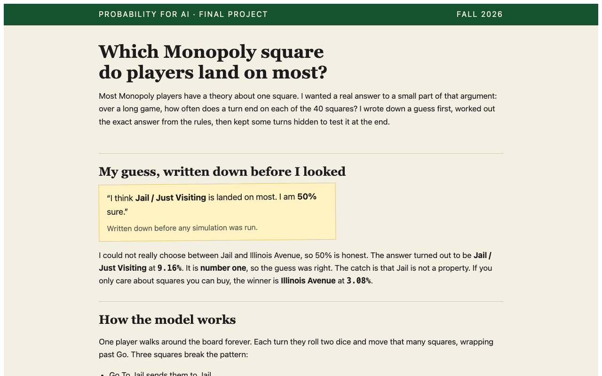

# Which Monopoly square do players land on most?

A final project for Stanford's **Probability for AI** course, Fall 2026.

I simulated Monopoly turns from the official rules to find where a turn
actually ends. The short answer: **Jail / Just Visiting**, at about 9% of
turns. The best *property* is **Illinois Avenue**, at 3.08%.



## The result

| Rank | Square | Chance a turn ends here |
| --- | --- | --- |
| 1 | Jail / Just Visiting | 9.16% |
| 2 | Illinois Avenue | 3.08% |
| 3 | Go | 3.01% |
| 4 | New York Avenue | 2.96% |
| 5 | B. & O. Railroad | 2.96% |

Jail is not a square you can buy, so the answer depends on the question. If
you only care about property, Illinois Avenue wins.

## The model

One player walks around the board forever. Each turn they roll two fair dice
and move that many squares, wrapping past Go. Three things break the pattern:

- Go To Jail sends them to Jail.
- Chance and Community Chest cards can move them again (advance, go back
  three, nearest railroad or utility, and so on).
- Being in Jail costs one lost turn.

The exact long-run answer comes from multiplying the one-turn chance matrix
by itself until it stops changing. The site then compares that with a direct
simulation.

Three simplifications: no extra turn after doubles, no money or houses, and
cards are drawn independently instead of leaving the deck.

## Did it work?

I fixed a seed and 200,000 turns before looking at any result, kept them in
`app/lockedTest.json`, and opened them once at the end.

- Average gap between the model and the hidden turns: **0.02 percentage
  points**
- Worst square: **0.06 points**
- Score (log₁₀ likelihood per turn): **−1.557**, against **−1.602** for a
  uniform guess
- The top square on the hidden turns was also Jail / Just Visiting

The numbers also match published Monopoly simulations, which was a useful
outside check.

## Run it

You need Node.js.

```sh
npm install
npm run dev
```

Then open the link it prints. To run the course's checks:

```sh
node tools/check.mjs
```

The site itself lives in `app/`, and that is the only folder the course
uploads. Everything else is for building and submitting.

## What is in here

| Path | What it is |
| --- | --- |
| `app/` | The website: `App.tsx`, the board, the two card decks, and the locked turns |
| `thumbnail/` | 16:9 project thumbnail |
| `video/` | The 50-second video and its narration script |
| `SOURCES.md` | Where the rules come from (no real data was used) |
| `AI-NOTES.md` | What the AI did and what I decided |
| `SUBMIT-ANSWERS.md` | The text answers for the course form |
| `tools/check.mjs` | The course's website checker |
| `COURSE-BUNDLE.md` | The original starter-bundle instructions |

## How AI was used

I used OpenCode with a DeepSeek model as a coding agent. It suggested the
project ideas and the Jail guess, wrote the code and the page, and checked
the numbers against published simulations. It also built the video from
screen recordings of the site.

My part was choosing Monopoly, accepting the 50% guess and the
simplifications, and reviewing the finished page. `AI-NOTES.md` has the full
log, including the parts that did not go smoothly.

## Data and sources

No real data. The board and both card decks come from Hasbro's Monopoly
rules, and every turn on the page is simulated. Details are in `SOURCES.md`.

Monopoly is a trademark of Hasbro. This is a class project and is not
affiliated with Hasbro.
